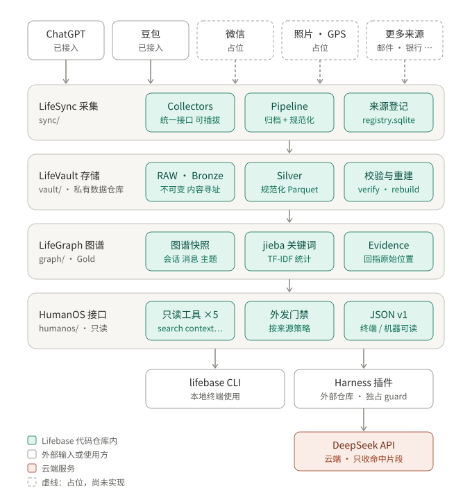
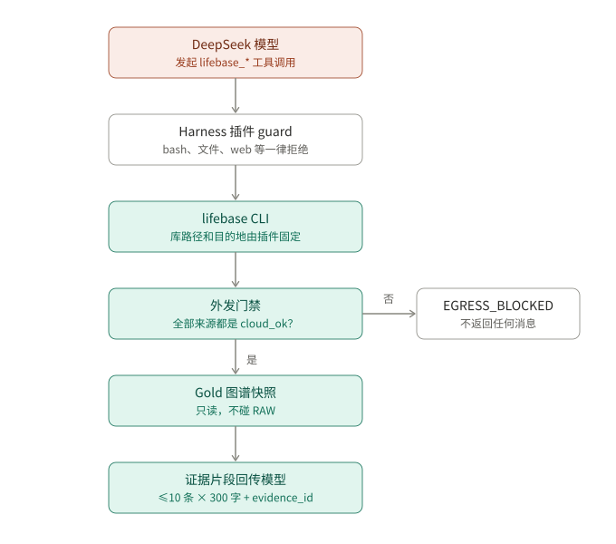

# Lifebase

**Local-first 个人数据基础设施**：持续采集、保存、规范化你分散在微信、照片、GPS、邮件、ChatGPT、GitHub、银行等各处的数字生活痕迹，形成有证据支撑、带时间语义的个人知识图谱，并在此之上构建个人 AI 应用。

> Own your data first. Intelligence comes later.

伞形名称 **Lifebase**；四层分别为 LifeSync / LifeVault / LifeGraph / HumanOS（命名决策见 `docs/adr/ADR-002`）。

## 架构



四层自上而下单向依赖：LifeSync 采集 → LifeVault 存储 → LifeGraph 图谱 → HumanOS 只读接口；
`core/` 提供跨层的统一封装与内容寻址。RAW、Silver 与图谱存放在独立 private 仓库
`Lifebase-data`，不在本代码仓库内。

顶部实线来源已接入，虚线为占位。新来源实现 `sync/base.py` 的 Collector 接口、在
`sync/collectors/__init__.py` 登记并声明外发级别（默认 `local_only`），即可复用归档、
规范化、校验与重建。现有图谱按会话与消息建模：微信等聊天来源可直接构图，照片、GPS、
银行等非聊天来源需先扩展 LifeGraph。

### 云端提问路径



模型只能调用 `lifebase_*` 工具，库路径与目的地由 Harness 插件固定。外发门禁按整份图谱的
来源策略判断，任一来源不是 `cloud_ok` 即返回 `EGRESS_BLOCKED`；当前 ChatGPT、豆包为
`cloud_ok`（[ADR-021](docs/adr/ADR-021-聊天来源恢复云端可用与真实库试运行.md)）。

## 当前状态

截至 **2026-10-21**，已接入 ChatGPT ZIP 与 doubao-helper JSON：来源文件 →
RAW 归档 → canonical v1 → Parquet → DuckDB 查询；已实现
`ingest`、`list`、`query`、`verify`、`rebuild`、`quality` 六个 CLI 命令，
collector 经来源注册表（`sync/collectors/__init__.py`）路由，支持目录导入及多来源重放。

已记录 1,000 / 10,000 / 50,000 基础消息的合成规模基线。
collector/parser `chatgpt@0.2.0` 支持编号会话文件、
仅 parent 的节点及混合内容中的字符串。单份真实导出已完成 125 个会话、5,882 条
消息与 6,007 条证据的导入、完整性检查、聚合查询、重复导入和重放验收。
doubao@0.1.0 的三份本地导出包含 3 个会话、5,266 条消息、5,269 条证据，重复导入
和混合来源重放保持持久化文件不变。全部数据检查没有错误；合并仓库 verify 为 warning，
仅因两个已有 Finder .DS_Store 文件。豆包会话时间、回复关系与覆盖范围仍有缺口。
LifeGraph 的自动关键词图谱及 HumanOS 数据接口已实现：`graph build/status`、
`topics`、`search`、`timeline`、`evidence`、`context`，支持可读终端和 JSON v1。
真实本地库的 128 个会话、11,148 条消息已构图；RAW/Silver/索引保持原状。
HumanOS 准备证据上下文；DeepSeek Harness 插件已在合成库上联调云端模型的工具调用与引用回答，
真实库经 ADR-021 批准可由云端模型回答（仅 DeepSeek 官方 API）。
完整验收、待验证事项与下一步见 [当前阶段](docs/reference.md#2-项目背景与当前阶段)，
接入方式见 [Harness 接口说明](docs/harness-interface.md)。

真实库和合成库已迁入独立的 private `Lifebase-data` 仓库，分别位于
`libraries/personal/`、`libraries/demo/`；原本机路径是兼容链接。来源导出、LFS
同步和多设备维护入口见 [数据仓库说明](docs/data-repository.md)。

## 快速开始

### 开发环境

在已安装 conda 的设备上，从仓库根目录执行（macOS / Linux）：

```bash
conda env create --file environment.yml
conda activate lifebase
conda env config vars set --name lifebase "UV_PROJECT_ENVIRONMENT=$CONDA_PREFIX"
conda deactivate
conda activate lifebase
uv sync --locked --extra dev --inexact
```

退出后重新激活，用于加载刚保存的环境变量。Windows PowerShell 用户将第三条命令改为：

```powershell
conda env config vars set --name lifebase "UV_PROJECT_ENVIRONMENT=$env:CONDA_PREFIX"
```

之后每次开发只需 `conda activate lifebase`。`UV_PROJECT_ENVIRONMENT` 指向这台设备上
的专用 conda 环境，让 uv 将项目及其依赖安装在其中。同步时保留 `--inexact`，以保留
conda 安装的工具包。

配置文件分工：

- `environment.yml`：环境名称、Python 3.12、pip 和固定版本的 uv。
- `pyproject.toml`：项目依赖与开发依赖的声明。
- `uv.lock`：锁定 Python 库版本和分发文件哈希，供其他设备及 CI 安装同一组库版本。

这些文件不包含本机环境路径；conda 的底层系统包会按设备平台解析，并非逐字节复制
整套环境。已有环境在拉取依赖变更后，重新执行 `uv sync --locked --extra dev --inexact`。
有意升级依赖时执行 `uv lock --upgrade`，再同步并验证。

若 `uv sync` 报证书错误（精简 conda 环境缺少 CA 证书），先 `pip install certifi`，
再用 `conda env config vars set --name lifebase "SSL_CERT_FILE=<该环境 site-packages 下
certifi/cacert.pem 路径>"` 持久化指向，重新激活后生效。

### 本地验证

```bash
uv run ruff check .
uv run pytest
```

### 导入与查询

想先体验当前功能，可跟随 [双来源终端演示](docs/demo.md)：使用合成 ChatGPT / Doubao
样例，在 `~/Lifebase-demo` 里自动构图、读会话、搜索主题、按时间筛选、追溯证据、
准备上下文，以及验证重复导入与构图。初始样例有 3 个会话、8 条消息、11 条证据；
演示约需 10–15 分钟，依赖已包含锁定的 jieba。

```bash
lifebase --data-dir ~/Lifebase-demo graph build
lifebase --data-dir ~/Lifebase-demo search "野餐"
lifebase --data-dir ~/Lifebase-demo context "野餐有哪些讨论？" --format json
```

Gold 使用独立 Parquet 快照；新输入使旧图谱过期，需要显式 `graph build`。
`verify` 检查 RAW/Silver，`graph status` 检查 Gold。统计主题不做语义融合，消息时间、
角色及内容版本保持可见。后续范围见 [切片与联调交接](docs/design/post-collector-roadmap-proposal.md)。

进入开发环境后，先用仓库内的合成样例试跑；输出目录放在仓库外：

```bash
lifebase --data-dir ~/Lifebase-demo ingest --source chatgpt:synthetic-account tests/fixtures/chatgpt/export-a.zip
lifebase --data-dir ~/Lifebase-demo list
lifebase --data-dir ~/Lifebase-demo query "SELECT role, text_parts, occurred_at FROM artifacts ORDER BY occurred_at"
```

再导入同一文件，结果显示 `unchanged`；导入 `export-b.zip` 可以验证重叠来源与内容版本。

导入真实导出时，将 ZIP 放进 `~/Lifebase/inbox/`，执行：

```bash
lifebase ingest --source chatgpt:personal
lifebase list
lifebase query "SELECT count(DISTINCT record_id) AS messages FROM artifacts"
```

也可直接提供仓库外的 ZIP 路径：`lifebase ingest --source chatgpt:personal /path/to/export.zip`。

doubao-helper 的 JSON 可逐文件导入，也可直接扫描导出目录：

```bash
lifebase ingest --source doubao:personal ~/Downloads/doubao-export
lifebase quality --source doubao:personal
lifebase query --source doubao:personal "SELECT role, text_parts, occurred_at, known_at FROM artifacts ORDER BY occurred_at LIMIT 20"
```

`--source` 使用已登记的平台前缀并区分账户，例如 chatgpt:personal、doubao:personal，
不填写密钥。目录只扫描直接子文件，按选定来源检测，不匹配的文件列在 skipped 中；
显式文件路径直接进入归档与解析。未提供路径时按同样方式手动扫描 inbox；原文件
留在原处，RAW 内容归档到 `vault/objects/`，首次来源入库信息保存在
`vault/manifest.sqlite`，Source Registry 位于 `registry.sqlite`。

Silver 按来源、RAW 哈希与处理版本发布完整 Parquet 快照分区；查询合并这些分区，
对相同身份及版本去重。逻辑表为 `events`、`artifacts`、`evidence`；保留不同回复
分支和内容版本，因此 `count(*)` 是版本数，`count(DISTINCT record_id)` 是身份数。
`record_conflicts` 视图列出拥有多个版本且版本时间不足以确定次序的记录。

证据引用查询示例：

```bash
lifebase query "SELECT a.role, a.text_parts, e.content_hash, e.raw_member, e.raw_pointer FROM artifacts a JOIN evidence e USING (record_id, revision_id) WHERE e.record_kind = 'artifact' LIMIT 20"
```

命令输出 JSON；单个文件失败会保留 RAW、记录原因并返回非零退出码，批量导入继续
处理其他文件。`query` 只接受单条 SELECT / WITH SELECT，对 SQL 禁用外部文件和
网络访问；`list` / 空库查询不会创建数据目录。

ChatGPT 支持 ZIP 根目录中唯一的 `conversations.json` 数组，或从 0 起连续编号的
`conversations-000.json` 等文件。存在 `export_manifest.json` 时核对会话成员列表、
分片标记与数量及可选库存长度；没有 manifest 的编号文件按数字排序读取，并提醒
无法证明导出完整性。两种布局并存、成员重复或清单矛盾会报告错误。

节点可只提供 parent；显式提供 children 时仍核对关系一致性。`text` 逐段保留，
`multimodal_text` 仅提取字符串，非字符串内容仍保留 RAW；没有字符串时 text_parts
为 null。会话 JSON 单成员及合计上限均为 128 MiB，manifest 上限为 1 MiB，整个
ZIP 仍完整归档。加密 ZIP、媒体理解和其他内容类型解析尚未支持。

ChatGPT 缺失或异常时间保留空值并附诊断；消息无 update_time 时 known_at=null，但合法
create_time 仍进入 occurred_at。未知内容类型保留消息元数据与 RAW 引用。

Doubao 支持 source=doubao、每文件一个会话的 doubao-helper JSON。优先使用
API 会话身份，核对消息 ID 与 raw 对象身份；text 原样进入 text_parts，消息
raw.create_time / update_time 按 Unix 秒映射到 occurred_at / known_at。
会话时间及消息 parent_record_id 为空，exportedAt 不填入来源时间。单文件读取
上限为 128 MiB；证据 raw_member="" 指整个 JSON，raw_pointer="" 指会话根，
`/messages/0` 等指消息。原文件完整归档，解析器不处理媒体或重新提取 raw 中的文本。

工具导出可能已筛选和去重，rawCount 差异与提前停止都会附诊断；no-more 不能
证明账户覆盖完整。quality 只统计已导出的记录，覆盖范围仍为空。具体映射见
[ADR-015](docs/adr/ADR-015-豆包JSON导入与多来源重放.md)。
查询目前将登记的 Parquet 分区载入内存，适合原型规模数据。

契约见 [canonical v1](docs/design/chatgpt-minimal-contract-draft.md)，具体行为由合成
端到端测试覆盖。后续真实数据验证在本代码仓库外进行。

### 只读完整性检查

停止向数据目录写入后执行：

```bash
lifebase --data-dir ~/Lifebase-demo verify
# 默认检查 ~/Lifebase
lifebase verify
```

输出 JSON：`status`、`counts` 和 `issues`。检查包括 RAW 内容地址与归档长度、
两个 SQLite 索引、全部已发布 Silver 分区的哈希/schema/行数/处理身份、规范化
记录关联，以及证据的 ZIP 成员或整个 JSON 哈希、JSON Pointer 和来源记录 ID。问题包含稳定
`code`、相对数据目录的 `path`，证据问题还包含 `evidence_id`；不输出消息正文。

状态 `ok` 返回 0；错误返回 1。未登记的对象、分区和临时目录作为 `warning`
报告，同样返回 1，供人工检查；不会修复、重新登记或清理。正常归档但解析失败的
输入只检查归档完整性，解析失败原因仍由 `list` 查看。

不存在的数据目录视为空库，返回 0 且不创建文件。为避免 SQLite 创建辅助文件或
恢复日志，检查使用只读 immutable 连接；发现 WAL/恢复日志时返回
`database_not_quiescent`，要求停止写入后重试。本版检查要求静止的数据目录，
不提供并发写入期间的一致性快照。文件内容、mtime 和权限保持不变；操作系统
可能因读取更新 atime。实现与边界见 [ADR-008](docs/adr/ADR-008-只读完整性检查.md)。

### 从 RAW 重建派生数据

保留 `vault/objects/` 和 `vault/manifest.sqlite`，即使 inbox 原文件不在，也可以执行：

```bash
lifebase --data-dir ~/Lifebase-demo rebuild
# 只重建某个账户来源
lifebase --data-dir ~/Lifebase-demo rebuild --source chatgpt:synthetic-account
lifebase --data-dir ~/Lifebase-demo verify
```

`rebuild` 按归档的 collector 类型使用当前安装的对应 collector/parser 和 schema 版本，从只读 manifest
恢复来源、原始文件名及首次入库时间，再读取并校验 RAW，重新解析、发布 Silver
和登记 Source Registry。它不会重新归档 inbox 文件，也不会修改 RAW 或 manifest。
缺失的完整分区和 registry 可重新生成；完整的已有分区在哈希与逻辑结果校验后复用。
已有分区或文件损坏时报告失败并保留现场，不覆盖或清理；manifest 丢失时无法推测
来源和首次入库时间。操作前停止向数据目录写入，manifest 有 WAL/恢复日志时拒绝重建。

输出 JSON 包含当前 `collector_version`、`parser_version`、`schema_version` 和逐条
`rebuilds`，状态为 `rebuilt`、`unchanged` 或 `error`。单条失败仍处理其他归档，整体
`partial` / `error` 返回 1，全部成功返回 0。空库或未匹配来源返回空列表，不创建目录。
混合来源或处理版本时，顶层 collector_version / parser_version 为 null，每条
rebuilds 分别给出当前版本；单一版本继续给出顶层值。历史无前缀 ChatGPT 来源仍可
按已保存的归档类型重放，新导入需提供平台前缀。

处理版本升级会新增分区，旧分区保留。默认 query 继续合并全部成功分区；需要核对
某次重建结果时，使用 rebuild 输出的版本显式筛选，例如当前版本：

```bash
lifebase --data-dir ~/Lifebase-demo query --source chatgpt:synthetic-account --parser-version chatgpt@0.2.0 --schema-version 1 "SELECT count(*) FROM artifacts"
```

还可使用 `--collector-version`；多个筛选条件同时满足才会选入分区。筛选仅选择已有
产物，不安装或执行历史解析器。若同一个处理版本生成不同逻辑数据，重建会报错，
应先核对变化原因并升级 parser 版本。决策见 [ADR-009](docs/adr/ADR-009-RAW重放与处理版本选择.md)。

### 导入质量与规模基线

ingest 和 rebuild 的单条成功结果包含 `quality`；也可以汇总已登记的成功分区：

```bash
lifebase --data-dir ~/Lifebase-demo quality
lifebase --data-dir ~/Lifebase-demo quality --source chatgpt:synthetic-account --parser-version chatgpt@0.2.0 --schema-version 1
```

报告区分会话和消息的 `identities`（身份数）与 `versions`（内容版本数），统计
`missing_occurred_at_versions`、`missing_known_at_versions`、文本版本、空文本版本、
不支持的内容类型及数量，并列出证据数。时间缺失、异常或不可靠而变成 NULL 的
版本都计入缺失时间；具体解析原因仍在单次导入 `issues` / 来源 `diagnostics` 中。
空文本仅指空数组或全部为空字符串，空白字符保持原样。非文本内容保留 RAW 和
消息元数据，报告中的“不支持”表示本版没有完整规范化其内容，不表示 RAW 丢失。

`text_versions` 只计 `text` 类型；`multimodal_text` 即使提取出字符串，仍列在不支持
内容类型统计中，表示该类型没有完整解析。查询可提取文本时使用 `text_parts IS NOT NULL`，
不要只按 `content_format='text'` 筛选。ChatGPT 单份真实导出验收中，quality 为 warning：
消息 known_at 全部为空、14 条空文本版本及部分内容类型未完整解析；109 条
multimodal_text 记录提取到字符串。此验收不代表账户覆盖完整或媒体已被理解。
豆包三份导出的消息 creation/update 时间均有值，无空文本；quality 为 warning，
因为会话时间为空。其全部 text_versions 仅指工具已导出的文本，不涵盖过滤掉的
消息、回复关系或未处理的媒体；这些范围限制由来源 diagnostics 说明。

`quality.status` 为 empty / ok / warning；warning 是质量提醒，成功生成报告仍返回
0，不会把有效归档改判为导入失败。存储损坏导致查询失败则返回 1，可用 verify 定位。
汇总只覆盖 `selected_partitions` 指定的成功分区，按逻辑行去重；失败导入由 list 查看。
报告仅输出统计，不输出消息正文；ok 不等于已覆盖整个账户或理解全部媒体。

完整规模基准仅使用生成的合成数据，在仓库根目录按需执行：

```bash
uv run python -m benchmarks.run --sizes 1000 10000 50000 --repeats 3 --output docs/benchmarks/quality-scale-baseline.json
```

每档包含两个重叠导出：第二份新增约 5% 消息，修改每第 101 条旧消息，并包含
分支、缺失时间与非文本。分别测量首次导入、重复导入、聚合查询和质量报告的
操作耗时与进程峰值 RSS；导出生成不计入测量，各阶段使用独立进程。
全部输入和仓库均位于工具自己的临时目录，结束后清理。CI 只验证小样例正确性，
不运行完整基准，也不设机器相关的耗时阈值。

方法、结果及限制见 [规模基线](docs/benchmarks/README.md)，决策见
[ADR-010](docs/adr/ADR-010-导入质量报告与合成规模基线.md)。

## 安全红线

本代码仓库只包含代码、schema、文档与合成测试数据。独立 private 数据仓库的授权范围
和规则以 [AGENTS.md](./AGENTS.md) 为唯一事实源，目录与同步方式见
[数据仓库说明](docs/data-repository.md)。本机原有数据路径保留为兼容链接。

## 更多

- Agent 规则与红线（唯一事实源）：`AGENTS.md`
- 架构决策：`docs/adr/`
